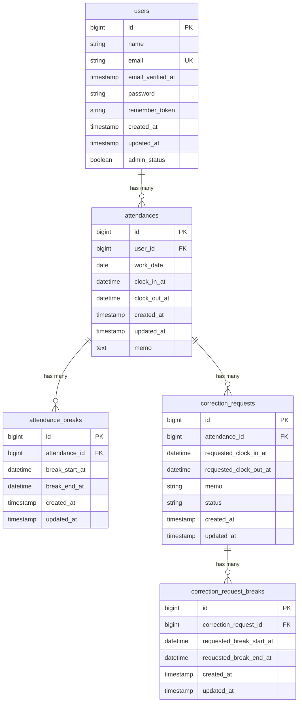

# COACHTECH 勤怠管理アプリ

出勤・退勤・休憩の打刻と、勤怠情報の確認・修正申請を行うWebアプリケーションです。
一般ユーザーは自分の月次勤怠や修正申請を確認できます。
管理者は全ユーザーの日次勤怠、スタッフ別の月次勤怠を確認し、勤怠の直接修正や修正申請の承認を行うことができます。

## 作成者

志賀 由美子

## 使用技術

- PHP 8.5（Laravel Sailの設定）
- Laravel 10.50.3
- Laravel Fortify 1.36.2
- MySQL 8.4（Dockerイメージの指定）
- Laravel Sail 1.69.0
- Vite 5.4.21
- Docker / Docker Compose

Laravel・Fortify・Sail・Viteのバージョンは、リポジトリのロックファイルに基づきます。

## ER図



### 設計上の補足

- `attendances`の`user_id`と`work_date`に複合UNIQUE制約を設定し、同じユーザーの同じ日の勤怠が重複しないようにしています。
- 退勤前の`clock_out_at`と、休憩終了前の`break_end_at`はNULLになります。
- 勤怠と修正申請、通常の休憩と申請された休憩は、それぞれ別のテーブルで管理しています。
- 修正申請の状態は`pending`（承認待ち）と`approved`（承認済み）で管理しています。
- 管理者の承認時に、申請された出退勤時刻・休憩・備考を勤怠に反映します。休憩は申請された内容に置き換えます。

## 開発環境URL

| 画面                                               | URL                                            |
| -------------------------------------------------- | ---------------------------------------------- |
| 一般ユーザーログイン                               | http://localhost/login                         |
| 会員登録                                           | http://localhost/register                      |
| 勤怠打刻                                           | http://localhost/attendance                    |
| 一般ユーザーの勤怠一覧                             | http://localhost/attendance/list               |
| 管理者ログイン                                     | http://localhost/admin/login                   |
| 管理者の勤怠一覧                                   | http://localhost/admin/attendance/list         |
| スタッフ一覧                                       | http://localhost/admin/staff/list              |
| 申請一覧（ログインユーザーの権限で表示を切り替え） | http://localhost/stamp_correction_request/list |
| phpMyAdmin                                         | http://localhost:8080                          |
| Mailpit                                            | http://localhost:8025                          |

## 動作環境

DockerおよびLaravel Sailを使用した開発環境で動作します。
事前にDocker Desktopをインストールし、起動してください。

WebアプリケーションはLaravel、データベースはMySQLを使用しています。
フロントエンドの開発・ビルドにはViteを使用しています。

## 環境構築手順

### 1. リポジトリをクローン

```bash
git clone https://github.com/totosmy2718-netizen/attendance-app.git
cd attendance-app
```

### 2. .envファイルの準備

`.env.example`をコピーして`.env`を作成します。

```bash
cp .env.example .env
```

`.env`のデータベース接続設定を、以下のように変更します。
`DB_HOST`にはDocker Composeのサービス名である`mysql`を指定します。

```dotenv
APP_URL=http://localhost

DB_CONNECTION=mysql
DB_HOST=mysql
DB_PORT=3306
DB_DATABASE=attendance_app
DB_USERNAME=sail
DB_PASSWORD=password
```

さらに、Sailで使用するユーザーID・グループIDを`.env`に追記します。

```bash
printf '\nWWWUSER=%s\nWWWGROUP=%s\n' "$(id -u)" "$(id -g)" >> .env
```

### 3. Composer依存パッケージのインストール

```bash
docker run --rm \
  -u "$(id -u):$(id -g)" \
  -v "$(pwd):/var/www/html" \
  -w /var/www/html \
  -e COMPOSER_CACHE_DIR=/tmp/composer_cache \
  laravelsail/php82-composer:latest \
  composer install --ignore-platform-reqs
```

このコマンドはComposer依存パッケージの導入に使用します。
アプリケーションの実行環境は、`compose.yaml`で指定したPHP 8.5です。

### 4. Laravel Sailの起動

```bash
./vendor/bin/sail up -d
```

初回起動では、イメージの取得・ビルドに時間がかかる場合があります。
MySQLの起動が完了してから、次の手順に進んでください。

### 5. アプリケーションキーの生成

```bash
./vendor/bin/sail artisan key:generate
```

### 6. データベースのマイグレーションと初期データ投入

```bash
./vendor/bin/sail artisan migrate --seed
```

Seederにより、一般ユーザー2名・管理者1名と、勤怠・休憩の初期データが登録されます。
現在の初期勤怠は、2026年10月5日・6日のデータです。
一覧の表示月・表示日をこの日付に変更すると確認できます。

#### 動作確認用アカウント

| 区分         | 名前       | メールアドレス    | パスワード |
| ------------ | ---------- | ----------------- | ---------- |
| 一般ユーザー | Test User  | user1@example.com | password   |
| 一般ユーザー | Test User2 | user2@example.com | password   |
| 管理者       | Test Admin | user3@example.com | password   |

一般ユーザーは`/login`、管理者は`/admin/login`からログインしてください。

### 7. フロントエンドの準備

依存パッケージをインストールします。

```bash
./vendor/bin/sail npm ci
```

開発時は、Viteを起動します。別のターミナルで実行し、画面確認中は起動したままにしてください。

```bash
./vendor/bin/sail npm run dev
```

Viteの開発サーバーを起動せずに確認する場合は、以下でビルドします。

```bash
./vendor/bin/sail npm run build
```

### 8. アプリケーションへのアクセス

一般ユーザーログイン：

http://localhost/login

管理者ログイン：

http://localhost/admin/login

phpMyAdmin：

http://localhost:8080

## テスト実行

認証、打刻、勤怠一覧・詳細、修正申請、管理者による勤怠修正・承認などのFeature Testを実装しています。
テストでは`phpunit.xml`の設定により、SQLiteのインメモリデータベースを使用します。

すべてのテストを実行する場合：

```bash
./vendor/bin/sail artisan test
```

Feature Testのみ実行する場合：

```bash
./vendor/bin/sail artisan test tests/Feature
```

特定のテストを実行する場合（例：打刻機能）：

```bash
./vendor/bin/sail artisan test --filter=AttendanceTest
```

## 機能一覧

### 一般ユーザー

- 会員登録
- ログイン・ログアウト
- 現在の日時・勤務ステータスの表示
- 出勤・退勤の打刻
- 休憩開始・終了の打刻（1日に複数回対応）
- 月次勤怠一覧の表示・前月／翌月への切り替え
- 勤怠詳細の表示
- 出退勤時刻・休憩時刻・備考の修正申請
- 承認待ち・承認済み申請の一覧表示
- 承認待ちの勤怠の編集制限

### 管理者

- 管理者ログイン・ログアウト
- 日次勤怠一覧の表示・前日／翌日への切り替え
- 勤怠詳細の表示・直接修正
- スタッフ一覧の表示
- スタッフ別の月次勤怠一覧・前月／翌月への切り替え
- 全一般ユーザーの承認待ち・承認済み申請の一覧表示
- 修正申請詳細の表示・承認
- 承認内容の勤怠への反映

## 主なルート一覧

ブラウザから利用する画面・フォーム送信先です。
`{id}`は、表に記載した勤怠・スタッフ・申請のIDを表します。

| メソッド | URL                                      | 内容                                                       |
| -------- | ---------------------------------------- | ---------------------------------------------------------- |
| GET      | `/register`                              | 会員登録画面                                               |
| POST     | `/register`                              | 会員登録                                                   |
| GET      | `/login`                                 | 一般ユーザーログイン画面                                   |
| POST     | `/login`                                 | 一般ユーザーログイン                                       |
| POST     | `/logout`                                | 一般ユーザーログアウト                                     |
| GET      | `/attendance`                            | 勤怠打刻画面                                               |
| POST     | `/attendance`                            | 出勤・退勤・休憩の打刻                                     |
| GET      | `/attendance/list`                       | 本人の月次勤怠一覧                                         |
| GET      | `/attendance/{id}`                       | 勤怠詳細。管理者は管理者用詳細へ移動                       |
| POST     | `/attendance/{id}`                       | 一般ユーザーは修正申請、管理者は勤怠を直接修正             |
| GET      | `/application/{id}`                      | 本人の申請IDに対応する勤怠詳細へ移動                       |
| GET      | `/admin/login`                           | 管理者ログイン画面                                         |
| POST     | `/admin/login`                           | 管理者ログイン                                             |
| POST     | `/admin/logout`                          | 管理者ログアウト                                           |
| GET      | `/admin/attendance/list`                 | 管理者用の日次勤怠一覧                                     |
| GET      | `/admin/attendance/{id}`                 | 管理者用勤怠詳細                                           |
| GET      | `/admin/staff/list`                      | スタッフ一覧                                               |
| GET      | `/admin/attendance/staff/{id}`           | スタッフIDに対応する月次勤怠一覧                           |
| GET      | `/stamp_correction_request/list`         | 一般ユーザーは本人の申請、管理者は全一般ユーザーの申請一覧 |
| GET      | `/stamp_correction_request/approve/{id}` | 申請IDに対応する管理者用申請詳細                           |
| POST     | `/stamp_correction_request/approve/{id}` | 申請IDに対応する修正申請の承認                             |
